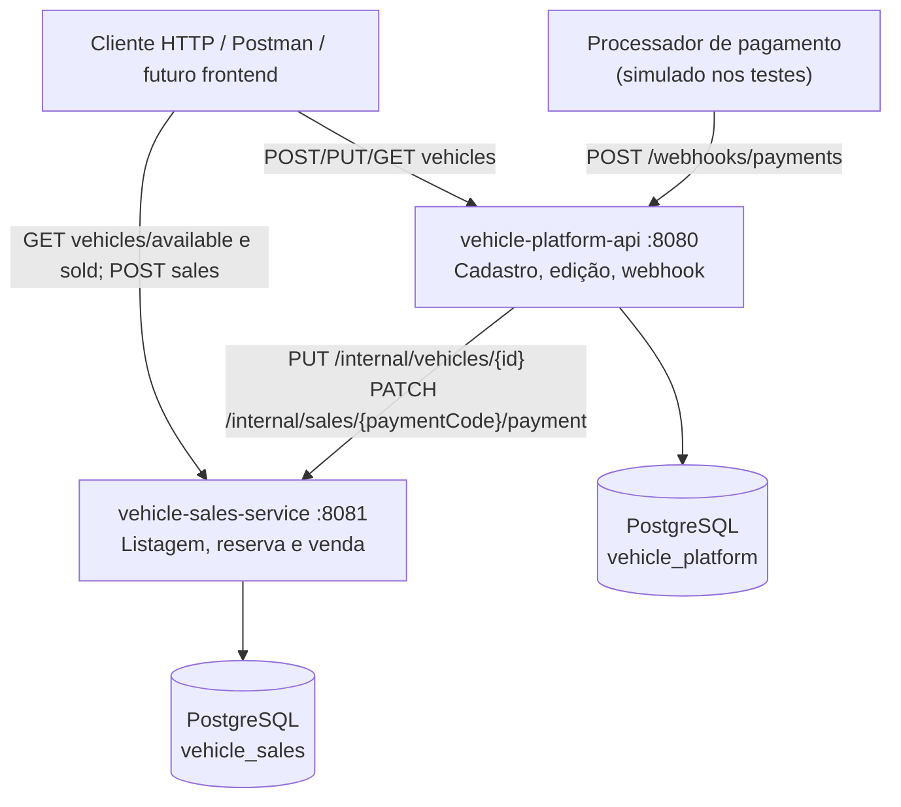

# Vehicle Sales Service

[](https://github.com/grecomilani/vehicle-sales-service/actions/workflows/ci.yml)

[](https://sonarcloud.io/summary/new_code?id=grecomilani_vehicle-sales-service)

[](https://sonarcloud.io/summary/new_code?id=grecomilani_vehicle-sales-service)

Serviço de **venda de veículos** da plataforma de revenda de veículos automotores,
desenvolvido como Trabalho Substitutivo do Tech Challenge — Fase 4 (Pós-Tech SOAT).

## O que é o projeto

A plataforma é composta por dois serviços que se comunicam via HTTP, cada um com
seu próprio banco de dados:

| Serviço | Responsabilidade |
|---|---|
| [`vehicle-platform-api`](https://github.com/grecomilani/vehicle-platform-api) | Cadastro e edição de veículos, webhook de pagamento |
| **`vehicle-sales-service`** (este repositório) | Listagem de veículos à venda e vendidos, compra de veículos e atualização do status de pagamento |

O serviço de vendas é isolado para suportar picos de acesso nos endpoints de
listagem e compra, e usa um banco de dados segregado.

## Diagramas técnicos completos

Para evitar um único diagrama excessivamente denso, a documentação detalhada está separada em duas visualizações Mermaid, renderizadas nativamente pelo GitHub:

1. **[Arquitetura de aplicação e infraestrutura](docs/architecture.md)** — dois microsserviços, Deployments, Services, ConfigMaps, Secrets, bancos PostgreSQL com StatefulSets/PVCs, pipeline CI/CD e escalonamento HPA do serviço de vendas.
2. **[Fluxo ponta a ponta (sequência)](docs/flow.md)** — cadastro, sincronização HTTP, listagem, compra, reserva, `paymentCode`, webhook e cenários `PAID` / `CANCELED`, incluindo bancos e serviços envolvidos.

Os diagramas representam o ambiente Kubernetes **efêmero** empregado no GitHub Actions, e não um cluster permanentemente hospedado.

## Stack

- Java 25 (LTS)
- Spring Boot
- springdoc-openapi (Swagger UI)
- Docker e Kubernetes (Kustomize)
- Maven
- PostgreSQL 17 (banco exclusivo deste serviço) + Flyway
- JUnit 5 + Testcontainers + JaCoCo (cobertura mínima de 80%)

## Fluxo de trabalho (Git Flow)

- `main`: branch principal de release. Um merge dispara o workflow de CD e a implantação temporária de validação no Kubernetes (não existe cluster de produção permanente nesta esteira).
- `develop`: branch de integração.
- `feature/<nome>`: criada a partir de `develop` e integrada via Pull Request.

Toda alteração deve ser registrada no [CHANGELOG.md](CHANGELOG.md).

## CI/CD

O workflow [`ci.yml`](.github/workflows/ci.yml) roda em todo Pull Request para
`develop`/`main` e em todo push para `feature/**`, `develop` e `main`:

1. Build do projeto com JDK 25.
2. Execução dos testes automatizados.
3. Verificação da cobertura mínima de **80%** (JaCoCo). O pipeline falha se
   a cobertura ficar abaixo do mínimo.
4. Publicação do resumo de cobertura no job e do relatório completo como
   artefato (`jacoco-report`).
5. **Pull Request automático** (job `auto-pull-request`), depois que todos os
   jobs de verificação passam:
   - push em `feature/*` abre o PR para `develop`;
   - push em `develop` abre o PR de release para `main`.

   O pipeline **não faz merge**: o merge de cada PR é feito manualmente pelo
   GitHub, depois da revisão e com os checks verdes.

### Deploy contínuo (CD)

O workflow [`deploy.yml`](.github/workflows/deploy.yml) roda a cada merge na
`main` (release do Git Flow):

1. Build da imagem e publicação no GitHub Container Registry
   (`ghcr.io/grecomilani/vehicle-sales-service`, com a tag do commit e `latest`).
2. Criação de um cluster Kubernetes com [kind](https://kind.sigs.k8s.io/) no
   próprio runner, com o metrics-server (métricas de CPU para o HPA).
3. Deploy dos manifests de [`k8s/`](k8s) com a imagem fixada na versão do commit.
4. Espera do rollout do banco e da aplicação.
5. **Smoke test** ([`smoke-test.sh`](.github/scripts/smoke-test.sh)) contra o
   serviço implantado: sincronização de veículo, listagem à venda, compra,
   confirmação de pagamento e listagem de vendidos.
6. Em caso de falha, o job imprime o diagnóstico (pods, eventos e logs).

**Limitação do ambiente de CD:** o cluster Kubernetes criado com `kind` existe apenas durante a execução do GitHub Actions; ao encerrar o runner, o cluster e seus recursos deixam de estar disponíveis. A pipeline comprova o deploy, o rollout e os smoke tests em infraestrutura efêmera, mas **não mantém um serviço público hospedado continuamente**. O workflow pode também ser iniciado manualmente (`workflow_dispatch`); o trigger automático é um `push` na `main`, normalmente gerado por merge.

### Evidências verificáveis (execuções de 01/10/2026)

| Evidência | Execução |
|---|---|
| CI: testes, gate JaCoCo de **80% de linhas**, build Docker e schemas Kubernetes | [GitHub Actions — CI](https://github.com/grecomilani/vehicle-sales-service/actions/runs/36810747655) |
| CD: deploy em cluster kind, rollout e smoke test HTTP | [GitHub Actions — CD](https://github.com/grecomilani/vehicle-sales-service/actions/runs/36810747613) |

O resumo de cobertura está na execução da CI, no job **Build, testes e cobertura (mínimo 80%)**; o relatório HTML é publicado como artefato `jacoco-report`. Essas execuções demonstram o resultado **naquela revisão**, não atestam automaticamente commits posteriores. Os links exigem permissão de acesso aos repositórios privados.

### Configuração necessária no GitHub

1. **Token de automação** (`PR_AUTOMATION_TOKEN`): PRs abertos com o token
   padrão do Actions não disparam novos workflows, então sem este token os
   checks do próprio PR não rodariam.
   - Crie um *fine-grained personal access token* em *Settings → Developer
     settings → Personal access tokens → Fine-grained tokens*, com acesso aos
     repositórios do projeto e as permissões **Contents: Read and write**,
     **Pull requests: Read and write** e **Workflows: Read and write**.
   - Cadastre-o em *Settings → Secrets and variables → Actions → New repository
     secret* com o nome `PR_AUTOMATION_TOKEN`.
2. **Excluir branches após o merge** (recomendado): *Settings → General → Pull
   Requests* → marcar **Automatically delete head branches**.
3. **Proteção de `main` e `develop`:** *Settings → Rules → Rulesets → New ruleset →
   Import a ruleset* e selecionar
   [`.github/rulesets/protect-main-develop.json`](.github/rulesets/protect-main-develop.json).
   O ruleset bloqueia push direto, force push e exclusão das branches e exige PR
   com o check *Build, testes e cobertura (mínimo 80%)* verde.

## Arquitetura

O código segue uma arquitetura em camadas, com as dependências apontando para o
domínio:

```
domain/          Regras de negócio (Vehicle, VehicleStatus, exceções)
application/     Casos de uso e portas (interfaces), sem dependência do Spring
infrastructure/  Adaptadores: web (controllers), persistência (JPA) e configuração
```

### Visão da arquitetura



Os bancos são isolados: nenhum serviço consulta diretamente as tabelas do outro. O serviço principal sincroniza o cadastro e encaminha resultados de pagamento por HTTP; o serviço de vendas controla disponibilidade, reserva, compra e o estado final da venda.

## API

Documentação interativa (Swagger UI): <http://localhost:8081/swagger-ui.html>
· especificação OpenAPI: <http://localhost:8081/v3/api-docs>

### Endpoints públicos (consumidos pelo frontend)

| Método | Rota | Descrição |
|---|---|---|
| `GET` | `/vehicles/available?page=0&size=20` | Veículos à venda, do mais barato para o mais caro |
| `GET` | `/vehicles/sold?page=0&size=20` | Veículos vendidos (pagamento confirmado), do mais barato para o mais caro |
| `POST` | `/sales` | Efetua a compra de um veículo |

As listagens são paginadas: `page` começa em `0`, e `size` tem padrão `20` e máximo
`100`. Exemplo de resposta:

```json
{
  "content": [
    {"id": "3f1c2a4e-...", "brand": "Fiat", "model": "Uno", "year": 2015,
     "color": "Branco", "price": 30000.00, "status": "AVAILABLE"}
  ],
  "page": 0,
  "size": 20,
  "totalElements": 1,
  "totalPages": 1
}
```

#### Compra de veículo

```bash
curl -X POST http://localhost:8081/sales \
  -H 'Content-Type: application/json' \
  -d '{"vehicleId":"3f1c2a4e-8b7d-4c1a-9e2f-1a2b3c4d5e6f","buyerCpf":"529.982.247-25","saleDate":"2026-10-01"}'
```

A compra reserva o veículo (ele deixa de aparecer na listagem de veículos à venda)
e cria a venda com o pagamento `PENDING`. O `paymentCode` retornado é usado pela
entidade processadora de pagamentos para informar se o pagamento foi efetuado
ou cancelado.

| Status | Quando |
|---|---|
| `201 Created` | Venda criada, aguardando pagamento |
| `400 Bad Request` | Dados inválidos (ex.: CPF inválido) |
| `404 Not Found` | Veículo não encontrado |
| `409 Conflict` | Veículo já reservado/vendido, ou compra simultânea do mesmo veículo |
| `422 Unprocessable Content` | Data da venda no futuro |

Compras simultâneas do mesmo veículo são tratadas com controle de concorrência
otimista e com um índice único no banco: apenas uma é efetivada e as demais
recebem `409`.

### Endpoints internos (chamados pelo `vehicle-platform-api`)

| Método | Rota | Descrição |
|---|---|---|
| `PUT` | `/internal/vehicles/{id}` | Cria ou atualiza um veículo (sincronização do cadastro) |
| `PATCH` | `/internal/sales/{paymentCode}/payment` | Registra o resultado do pagamento (`PAID` ou `CANCELED`) |

Exemplo:

```bash
curl -X PUT http://localhost:8081/internal/vehicles/3f1c2a4e-8b7d-4c1a-9e2f-1a2b3c4d5e6f \
  -H 'Content-Type: application/json' \
  -d '{"brand":"Toyota","model":"Corolla","year":2022,"color":"Prata","price":85000.00}'
```

| Status | Quando |
|---|---|
| `201 Created` | Veículo criado |
| `200 OK` | Veículo existente atualizado |
| `400 Bad Request` | Campos inválidos (a resposta lista os campos em `errors`) |
| `409 Conflict` | Veículo reservado ou vendido não pode ser alterado |
| `422 Unprocessable Content` | Regra de negócio violada (ex.: ano fora do intervalo permitido) |

#### Resultado do pagamento

```bash
curl -X PATCH http://localhost:8081/internal/sales/{paymentCode}/payment \
  -H 'Content-Type: application/json' \
  -d '{"status":"PAID"}'
```

| Resultado | Venda | Veículo |
|---|---|---|
| `PAID` | `PAID` | `SOLD` |
| `CANCELED` | `CANCELED` | `AVAILABLE` (volta para a listagem e pode ser comprado de novo) |

A operação é idempotente: reenviar o mesmo resultado retorna `200` sem alterar
nada. Um pagamento já finalizado não pode mudar para o outro resultado (`409`).
Código de pagamento inexistente retorna `404`.

Os erros seguem o formato [Problem Details (RFC 9457)](https://www.rfc-editor.org/rfc/rfc9457).

### Testar a compra e a confirmação do pagamento

A compra é feita neste serviço, mas **o webhook público é exposto pela API principal**, em `POST http://localhost:8080/webhooks/payments`. Para testar a integração real, suba os dois serviços com o [Compose da solução completa no repositório principal](https://github.com/grecomilani/vehicle-platform-api/blob/main/compose.solution.yaml).

1. Cadastre um veículo usando `POST http://localhost:8080/vehicles` e copie o `id`.
2. Faça `POST http://localhost:8081/sales` com `vehicleId`, CPF válido e `saleDate` não futura; copie o `paymentCode` retornado.
3. Confirme a compra simulando a processadora:

```bash
curl -i -X POST http://localhost:8080/webhooks/payments \
  -H 'Content-Type: application/json' \
  -d '{"paymentCode":"CODIGO_RETORNADO_PELA_COMPRA","status":"PAID"}'
curl -i http://localhost:8081/vehicles/sold
```

O veículo deve aparecer entre os vendidos. Reenviar `PAID` é idempotente (**200**); tentar `CANCELED` após confirmação gera conflito (**409**). Para o cenário `CANCELED`, **cadastre outro veículo, crie outra compra pendente** e envie o novo código ao mesmo webhook com status `CANCELED`: o veículo volta a `GET /vehicles/available`. Código desconhecido retorna **404**; status inválido retorna **400**. Não há processador de pagamento real nessa demonstração.

A rota interna `PATCH /internal/sales/{paymentCode}/payment` é utilizada **pela API principal** no encaminhamento HTTP; não é o webhook externo.

## Como executar localmente

Pré-requisitos: JDK 25 e Docker. Não é preciso instalar o Maven: o projeto usa o
Maven Wrapper.

1. Suba o banco de dados do serviço (PostgreSQL na porta `5433`):

   ```bash
   docker compose up -d
   ```

2. Inicie a aplicação:

   ```bash
   ./mvnw spring-boot:run
   ```

As migrações do Flyway são aplicadas automaticamente na inicialização.
A aplicação sobe na porta `8081` (altere com a variável `SERVER_PORT`).

| Variável | Padrão | Descrição |
|---|---|---|
| `SERVER_PORT` | `8081` | Porta HTTP da aplicação |
| `DB_HOST` | `localhost` | Host do PostgreSQL |
| `DB_PORT` | `5433` | Porta do PostgreSQL |
| `DB_NAME` | `vehicle_sales` | Nome do banco |
| `DB_USERNAME` | `vehicle_sales` | Usuário do banco |
| `DB_PASSWORD` | `vehicle_sales` | Senha do banco |
| `APP_TIME_ZONE` | `America/Sao_Paulo` | Fuso usado nas regras de data (ex.: data da venda) |

Para verificar se ela está no ar:

```bash
curl http://localhost:8081/actuator/health
```

## Executar com Docker

A imagem é gerada por um Dockerfile multi-stage: compila com o Maven Wrapper e
roda com a JRE 25, como usuário não-root.

Para uma execução portátil, prefira o **Docker Compose da solução completa**, que configura redes, dependências e os dois bancos automaticamente. Se optar por rodar apenas este serviço, use `docker compose up -d` para iniciar o banco e `./mvnw spring-boot:run` para iniciar a API. Evite combinar `--network host` e `-p` no `docker run`: o comportamento varia entre sistemas e, no modo host, o mapeamento de portas não é necessário.

Para subir **a solução completa** (os dois serviços e os dois bancos), use o
`compose.solution.yaml` do repositório
[`vehicle-platform-api`](https://github.com/grecomilani/vehicle-platform-api).

## Kubernetes

Os manifests ficam em [`k8s/`](k8s) e são aplicados com Kustomize
(`kubectl apply -k k8s/`):

| Arquivo | Conteúdo |
|---|---|
| `namespace.yaml` | Namespace `revenda-veiculos`, compartilhado pelos dois serviços |
| `database.yaml` | PostgreSQL exclusivo do serviço: Secret, Service e StatefulSet com volume persistente |
| `configmap.yaml` | Configuração da aplicação (host do banco, porta, fuso) |
| `deployment.yaml` | Deployment da aplicação: 2 réplicas, probes de startup/liveness/readiness e limites de recursos |
| `service.yaml` | Service `vehicle-sales-service` (ClusterIP, porta 8081) |
| `hpa.yaml` | HorizontalPodAutoscaler: de 2 a 6 réplicas conforme o uso de CPU, para os picos de acesso |

Exemplo de implantação em um cluster local com [kind](https://kind.sigs.k8s.io/):

```bash
kind create cluster --name revenda
docker build -t ghcr.io/grecomilani/vehicle-sales-service:latest .
kind load docker-image ghcr.io/grecomilani/vehicle-sales-service:latest --name revenda
kubectl apply -k k8s/
kubectl -n revenda-veiculos rollout status deployment/vehicle-sales-service
kubectl -n revenda-veiculos port-forward service/vehicle-sales-service 8081:8081
```

## Como testar

```bash
./mvnw verify
```

Os testes de integração usam **Testcontainers** para subir um PostgreSQL real,
então o Docker precisa estar em execução.

O comando executa os testes e gera o relatório de cobertura do JaCoCo em
`target/site/jacoco/index.html`. O build **falha** se a cobertura de linhas
ficar abaixo de **80%**.
