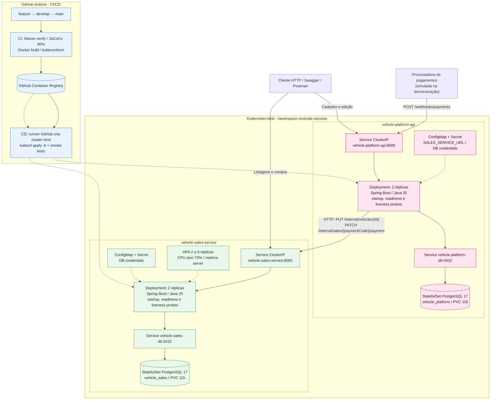

# Arquitetura — Vehicle Sales Service

Este diagrama representa **aplicação e infraestrutura reais**, com base em `k8s/`, `.github/workflows/` e nos contratos HTTP. O destaque é a listagem, a compra, os estados de venda e o escalonamento. Não há acesso cruzado entre os bancos.

## Legenda

- **Setas contínuas:** chamadas e dependências em execução; **tracejadas:** configuração, escalonamento ou implantação.
- **Deployment:** instâncias do serviço Java. **Service ClusterIP:** DNS e porta internos do cluster.
- **StatefulSet + PVC:** PostgreSQL com volume persistente no ambiente kind.
- **HPA:** escala exclusivamente o serviço de vendas de 2 a 6 réplicas, conforme CPU, com métricas do metrics-server.
- **CI/CD:** o cluster kind é **efêmero**, criado no runner do workflow e removido ao fim; não corresponde a um ambiente público de produção permanente.
- **Limite transacional:** cada banco tem transações locais. Chamadas HTTP entre serviços não compõem transação distribuída.

Para a jornada funcional detalhada, consulte [Fluxo de ponta a ponta](./flow.md).
