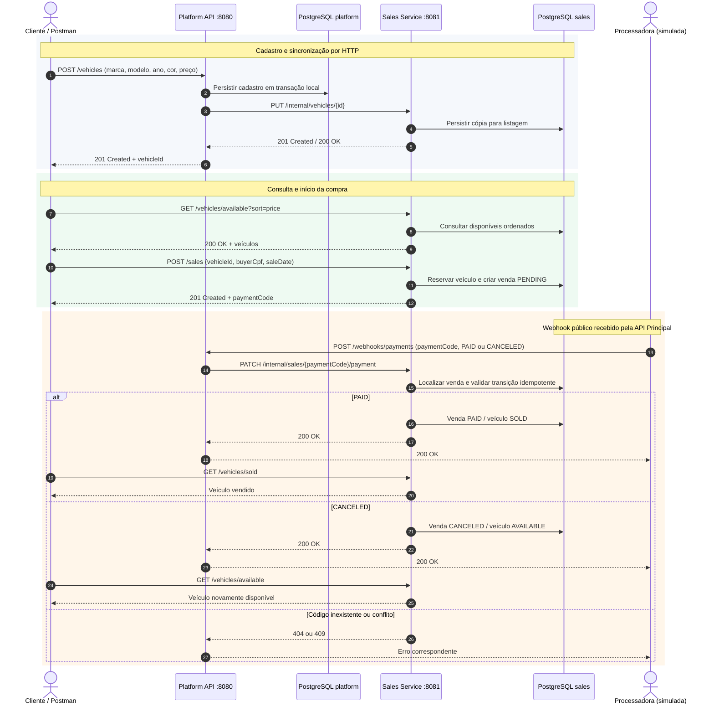

# Fluxo ponta a ponta — Vehicle Sales Service

A sequência mostra **os dois microsserviços e os dois bancos** porque a jornada atravessa os limites dos repositórios. A entrada inclui as listagens e a compra no Serviço de Vendas. O processador de pagamento é **simulado** para fins de teste.

## Infraestrutura envolvida nas etapas

| Etapa | Entrada HTTP | Componente Kubernetes | Persistência |
|---|---|---|---|
| Cadastro/edição | Platform API :8080 | Service → Deployment da API Principal | PostgreSQL `vehicle_platform` |
| Sincronização | `PUT /internal/vehicles/{id}` | Deployment principal → Service de Vendas :8081 | PostgreSQL `vehicle_sales` |
| Listagem/compra | Sales Service :8081 | Service → Deployment de Vendas (com HPA) | PostgreSQL `vehicle_sales` |
| Webhook | `POST /webhooks/payments` | Service → Deployment principal | Encaminha HTTP ao Serviço de Vendas |
| Confirmação/cancelamento | `PATCH /internal/sales/{paymentCode}/payment` | Service → Deployment de Vendas | PostgreSQL `vehicle_sales` |

**Observações:** o processamento do webhook é idempotente para reenvios do mesmo resultado. Um resultado contrário após a conclusão é rejeitado (`409`); código desconhecido recebe `404`. Falha de sincronização HTTP não equivale a rollback atômico dos dois bancos. O cluster kind usado no CD é temporário. Consulte também [Arquitetura e infraestrutura](./architecture.md).
